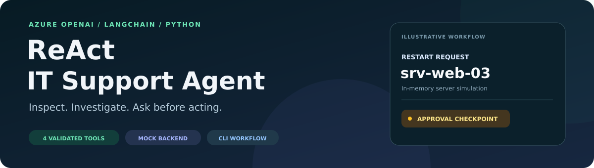
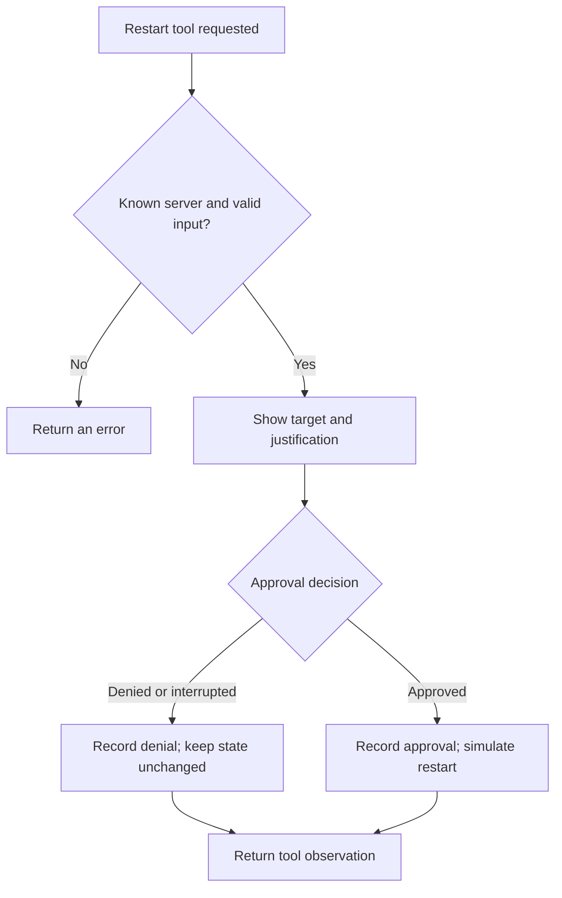

<p align="center">
  
</p>

<p align="center">
  <a href="#quick-start"></a>
  <a href="src/agent.py"></a>
  <a href="src/config.py"></a>
  <a href="tests/test_local.py"></a>
</p>

<p align="center">
  <strong>Investigate mock infrastructure. Review the evidence. Approve simulated changes.</strong><br>
  A Python CLI lab for ReAct-style tool use, structured validation, and human-in-the-loop control.
</p>

<p align="center">
  <a href="#quick-start">Quick start</a> ·
  <a href="#try-an-investigation">Example queries</a> ·
  <a href="#the-approval-checkpoint">Approval flow</a> ·
  <a href="#run-without-azure">Offline demo</a> ·
  <a href="#verification">Verification</a>
</p>

---

## What this agent does

A LangChain agent uses an Azure OpenAI chat deployment to inspect **mock server health**, look up **sample incidents**, and review **generated logs**. A fourth tool can simulate a restart after an approval decision. All infrastructure data and state changes live inside Python memory.

| 🔎 Observe | 🧩 Investigate | ✋ Review |
| --- | --- | --- |
| Inspect CPU, memory, disk, and status. | Connect incident details with generated log samples. | Approve or deny a proposed mock restart in the terminal. |

> **Project scope:** A Python CLI using native structured tool calls through LangChain's `create_agent`. Fourteen offline checks passed; live Azure model behavior has not been tested.

## Meet the tools

| Tool | Input | Behavior |
| --- | --- | --- |
| [check_server_health](src/tools.py) | `server_id` | Read mock CPU, memory, disk, and status |
| [lookup_incident](src/tools.py) | `incident_id` | Retrieve a sample ticket and its associated server |
| [analyze_logs](src/tools.py) | `server_id`, optional `lines` and `keyword` | Summarize generated entries; filter by text or log level |
| [restart_server](src/tools.py) | `server_id`, `reason` | Request approval, then update only the selected mock server |

Pydantic schemas reject extra fields, invalid ID formats, non-integer line counts, and counts outside **1–500**. Validation failures become audited `ERROR:` observations that the agent can report. Unknown IDs and simulated monitoring failures are also returned as errors.

## Quick start

Use **Python 3.11+**. Open the repository folder in VS Code or Terminal:

```bash
python3 -m venv .venv
source .venv/bin/activate
python -m pip install --upgrade pip
python -m pip install -r requirements.txt
cp .env.example .env
```

Edit the root `.env` with your Azure resource details:

```dotenv
AZURE_OAI_ENDPOINT=https://your-resource.openai.azure.com/
AZURE_OAI_KEY=replace-with-your-key
AZURE_OAI_DEPLOYMENT=your-chat-deployment-name
AZURE_OAI_API_VERSION=2024-10-21
MOCK_FAILURE_MODE=off
```

Use a chat deployment that supports tool calling. The deployment name can differ from the model name; the configured API version must be supported by your resource. Azure runs send the question and tool observations to that deployment and may incur usage charges.

<details>
<summary><strong>Windows PowerShell setup</strong></summary>

Replace the activation and copy commands with:

```powershell
.venv\Scripts\Activate.ps1
Copy-Item .env.example .env
```

Use `python` instead of `python3` when appropriate for your installation.

</details>

Start the interactive CLI:

```bash
python main.py
```

Or ask a single question:

```bash
python main.py "What's the health of srv-web-03?"
```

Useful options:

```bash
python main.py --read-only "Investigate srv-db-02 using incident INC1002."
python main.py --quiet "Look up incident INC1002."
python main.py --help
```

**Each question is independent.** The CLI does not carry conversation history between queries. Mock server state remains in memory for the lifetime of the process and resets on restart. The optional trace prints observable tool calls and results after the run; it does not expose hidden model reasoning.

## Try an investigation

| Ask | Explore |
| --- | --- |
| “What's the health of **srv-web-03**?” | The degraded web-server fixture |
| “Look up **INC1002** and identify its server.” | Incident lookup and routing |
| “Analyze 30 log lines for **srv-db-02**, filtered by **timeout**.” | Bounded log retrieval and filtering |
| “Check **srv-db-02**, inspect **INC1002**, and summarize its ERROR logs.” | Multiple tools in one investigation |
| “Check **srv-unknown-99**.” | An unknown-server observation |
| “Analyze **9999** lines for **srv-web-01**.” | Input-validation handling |
| “Restart **srv-web-03** because of the sustained CPU alert in **INC1001**.” | The terminal approval gate |

See [the sample query list](examples/sample_queries.txt) for more exercises. The fixtures include **six servers** and **three incidents**. Incident timestamps are supplied historical sample values. Log text and levels are generated, so they do not establish a real root cause.

## The approval checkpoint



The default prompt is **`Approve this action? [y/N]:`**. Only `y` or `yes` approves. Blank input, other answers, EOF, and Ctrl+C deny. Unknown servers are rejected before a prompt. If the approval event cannot be written to the audit log, execution stops before the mock restart.

The restart simulation updates status, CPU, and memory. It does not fix disk usage or resolve incident tickets. No real server, SSH connection, monitoring account, or ITSM system is contacted.

<details>
<summary><strong>Mock automation and failure modes</strong></summary>

For explicit non-interactive mock exercises, `HITL_AUTO_DECISION=approve` or `HITL_AUTO_DECISION=deny` replaces the console prompt. These decisions are logged as **`mode=auto`**, not as interactive human approvals. Leave this variable unset for the default prompt. `--read-only` removes the restart tool from the agent entirely.

`MOCK_FAILURE_MODE` controls the monitoring failure for `srv-web-03`:

| Mode | Behavior |
| --- | --- |
| `off` | Default; no simulated monitoring timeout |
| `always` | Every health request for that server times out |
| `random` | Approximately one-third of those health requests time out |

Other servers do not use the simulated timeout. These settings affect mock data only.

</details>

## Run without Azure

After installing the requirements, run the complete tool walkthrough:

```bash
python examples/run_demo.py
```

No Azure credentials or model requests are needed. The script exercises the actual tool implementations: health, incidents, logs, an unknown ID, invalid input, a timeout, and both denial and approval. It deliberately simulates the two approval outcomes and labels them as automated decisions. Mock server state is restored before it exits.

The console output is generated by the tools directly; it is not an LLM conversation. The example writes ten audit events to the local log during a normal run.

## Audit events

Tool observations, handled validation errors, and approval decisions append JSON records to `logs/audit_log.jsonl`. The directory is created on first use. Runtime logs are ignored by Git; the archive's old log is not included.

<details>
<summary><strong>Inspect an event locally</strong></summary>

```bash
python -c "from pathlib import Path; print(Path('logs/audit_log.jsonl').read_text())"
```

Events include a UTC timestamp and either a tool input/result summary or an approval action, details, decision, and mode. This is a local learning log. It does not authenticate an operator, provide tamper-evident storage, or reconstruct a complete agent/model transcript. Review logs before sharing, since tool inputs and restart justifications are recorded.

</details>

## Verification

```bash
python -m unittest discover -s tests -v
```

**Fourteen offline checks passed during preparation**, covering:

- Real LangChain graph execution with a scripted test model.
- Tool routing, validation observations, and the graph step limit.
- Health/incident lookups, unknown IDs, and simulated timeouts.
- Message-text and log-level filters, empty results, and audit records.
- Approved, denied, cancelled, and unavailable approval input.
- Blocking a restart when the approval log cannot be written.
- Read-only tool exposure, configuration, and observable traces.

The offline demo and CLI help command also passed. Tests use temporary audit files and restore mock state. **No live Azure call or production integration was run.** These checks validate execution mechanics rather than model reliability, triage accuracy, or operational efficiency. The badge reports a recorded local test run, not a CI status.

See [review notes](docs/review-notes.md) for tested versions and source corrections.

## Project map

| Path | Purpose |
| --- | --- |
| [main.py](main.py) | Interactive and one-shot CLI |
| [src/agent.py](src/agent.py) | Azure model, LangChain graph, and post-run trace |
| [src/config.py](src/config.py) | Root configuration and missing-setting checks |
| [src/tools.py](src/tools.py) | Four tool implementations and validation handling |
| [src/schemas.py](src/schemas.py) | Strict Pydantic contracts |
| [src/hitl.py](src/hitl.py) | Console approval and JSONL logging |
| [src/mock_data.py](src/mock_data.py) | In-memory server, incident, log, and restart fixtures |
| [examples/run_demo.py](examples/run_demo.py) | Offline walkthrough |
| [tests/test_local.py](tests/test_local.py) | Regression checks |
| [description.txt](description.txt) | Short GitHub repository description |

<details>
<summary><strong>Source, configuration, and references</strong></summary>

Prepared from the supplied `10B_react_agent.zip` training archive. Credentials, old audit output, Python bytecode, and macOS metadata are excluded. If any original keys are real, rotate them; removing a file does not revoke credentials. Never commit your own `.env`.

The project uses `langchain.agents.create_agent` with native structured tool calls. Its ReAct-style loop alternates model decisions, tool execution, observations, and a final answer. It does not parse text-based `Thought / Action` blocks. The source README's `AgentExecutor` settings and missing-demo claims have been corrected. A full authorship/license record was not supplied, so no blanket license has been assigned to the original material.

- [LangChain agents](https://docs.langchain.com/oss/python/langchain/agents)
- [LangChain tool validation handling](https://reference.langchain.com/python/langchain-core/tools/structured/StructuredTool)
- [LangChain AzureChatOpenAI](https://docs.langchain.com/oss/python/integrations/chat/azure_chat_openai)
- [Pydantic configuration](https://docs.pydantic.dev/latest/api/config/)

</details>

<p align="center"><a href="#quick-start">Back to quick start ↑</a></p>
